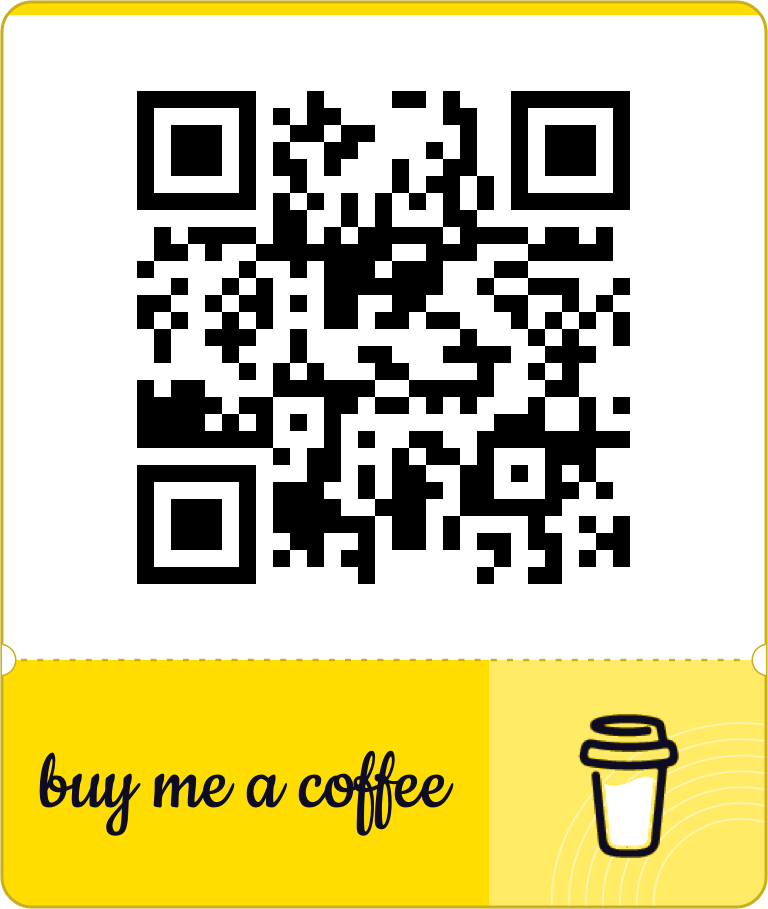

<picture>
  <source media="(prefers-color-scheme: dark)" srcset="assets/workbench-dark.svg">
  
</picture>

# Xiaomeng Zhao · myhloli

Hi, I’m **Xiaomeng**. I build open-source document parsers at [OpenDataLab](https://github.com/opendatalab).

## Selected work

**[MinerU](https://github.com/opendatalab/MinerU)**  
Turn PDFs and Office documents into Markdown and structured data for downstream applications.

**[DocVortex](https://github.com/myhloli/DocVortex)**  
Parse native documents into a common structure, then export to the formats you need.

## Supporting tools

- **[mineru-vl-utils](https://github.com/opendatalab/mineru-vl-utils)** — A Python toolkit for working with the MinerU vision-language model.
- **[mineru-llama-cpp](https://github.com/opendatalab/mineru-llama-cpp)** — In-process llama.cpp inference for MinerU.
- **[metafile-render](https://github.com/myhloli/metafile-render)** — Render WMF and EMF files as SVG, PNG, JPEG, or WebP.

## SPONSOR

开发不易，token 自费，感谢您对开源工作的支持。

  
  
  

## 知识星球

本地部署支持、解析问题与使用体验反馈、新功能预览及开发动态。

## Explore

[Blog](https://myhloli.com) · [Google Scholar](https://scholar.google.com/citations?user=BdakD8YAAAAJ) · [ORCID](https://orcid.org/0009-0007-3365-3090) · [Trendshift](https://trendshift.io/developers/8261)
